# share market browsing and the complete worship scene with an observer

Recorded-history integration scenario. A legal event history prepares the starting position directly in the emulator. This verifies the illustrated effect from that position; it does not demonstrate the player journey to reach it.

## The observer follows ordinary market browsing

<table>
<tr><th>Desktop · 1440 × 1000</th><th>Phone · 393 × 852</th></tr>
<tr>
<td valign="top"><a href="../../screenshots/share-market-browsing-and-the-complete-worship-scene-with-an-observer/000-market-desktop-darwin.png">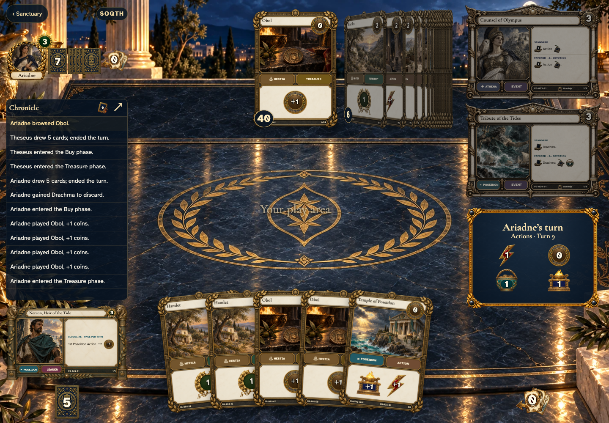</a></td>
<td valign="top"><a href="../../screenshots/share-market-browsing-and-the-complete-worship-scene-with-an-observer/000-market-phone-darwin.png">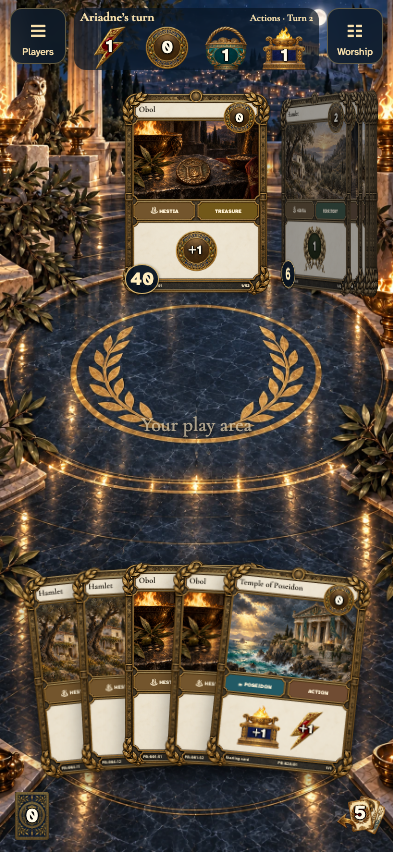</a></td>
</tr>
</table>

Tabletop · 3840 × 2160 — expand screenshot

<a href="../../screenshots/share-market-browsing-and-the-complete-worship-scene-with-an-observer/000-market-tabletop-4k-darwin.png">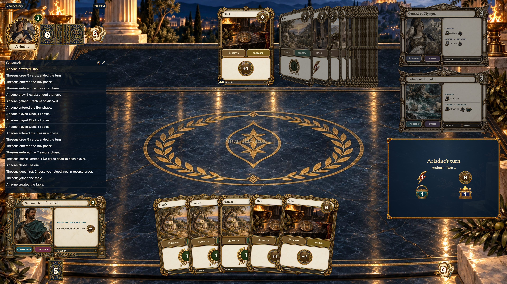</a>

- [x] Both offers center the same public pile.

## The observer sees Athena centered without actionable controls

<table>
<tr><th>Desktop · 1440 × 1000</th><th>Phone · 393 × 852</th></tr>
<tr>
<td valign="top"><a href="../../screenshots/share-market-browsing-and-the-complete-worship-scene-with-an-observer/001-focus-desktop-darwin.png">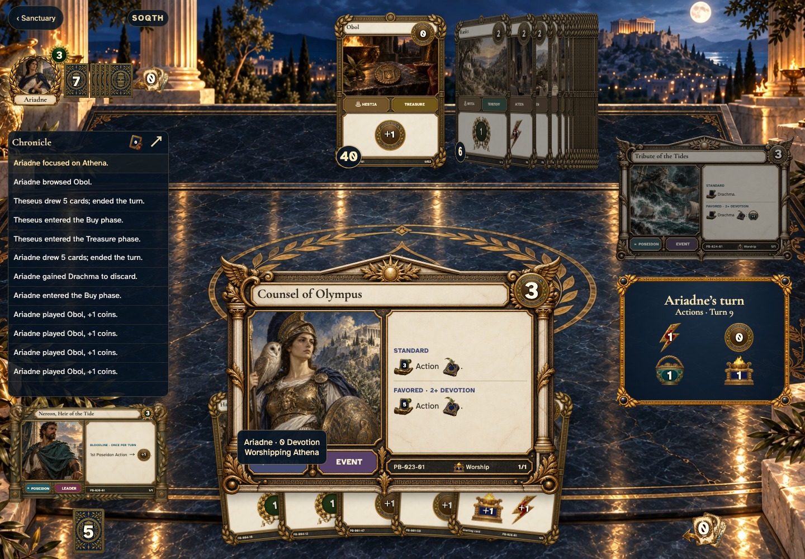</a></td>
<td valign="top"><a href="../../screenshots/share-market-browsing-and-the-complete-worship-scene-with-an-observer/001-focus-phone-darwin.png">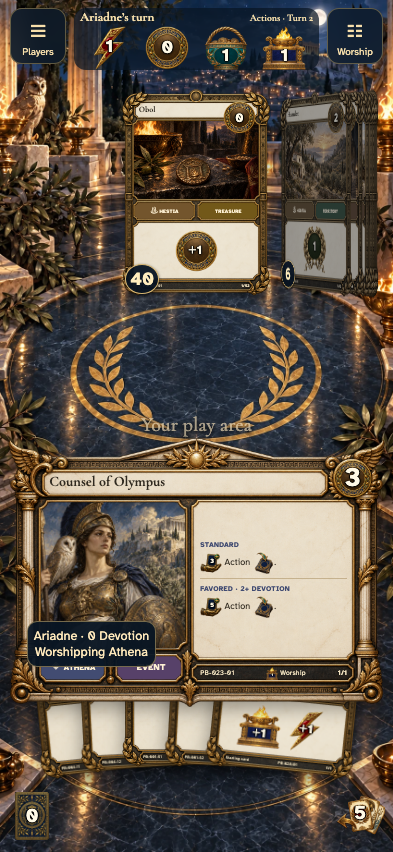</a></td>
</tr>
</table>

Tabletop · 3840 × 2160 — expand screenshot

<a href="../../screenshots/share-market-browsing-and-the-complete-worship-scene-with-an-observer/001-focus-tabletop-4k-darwin.png">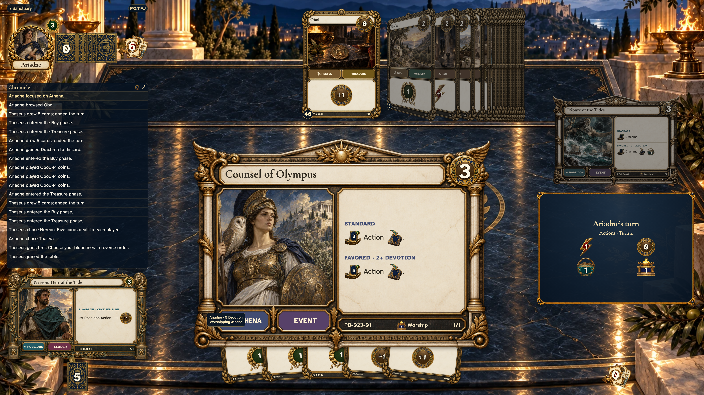</a>

- [x] Worship focus is shared before spending resources.

## The observer follows the public gain choice alongside Athena

<table>
<tr><th>Desktop · 1440 × 1000</th><th>Phone · 393 × 852</th></tr>
<tr>
<td valign="top"><a href="../../screenshots/share-market-browsing-and-the-complete-worship-scene-with-an-observer/002-choice-desktop-darwin.png">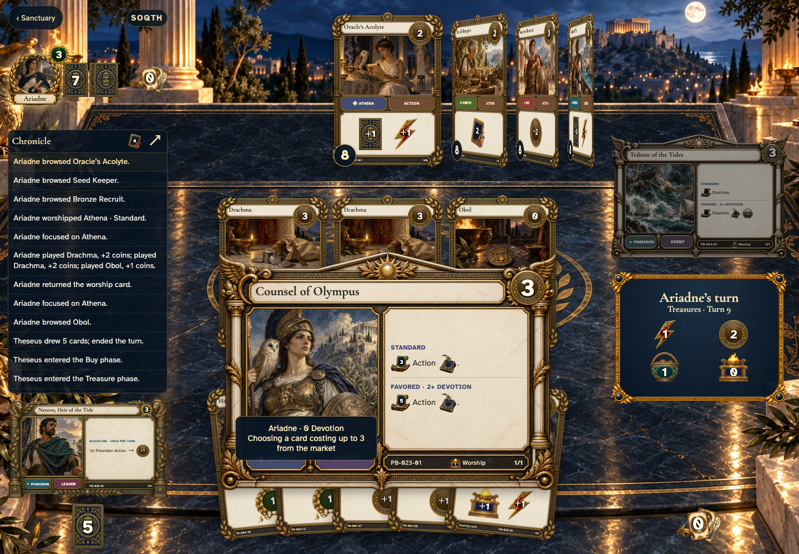</a></td>
<td valign="top"><a href="../../screenshots/share-market-browsing-and-the-complete-worship-scene-with-an-observer/002-choice-phone-darwin.png">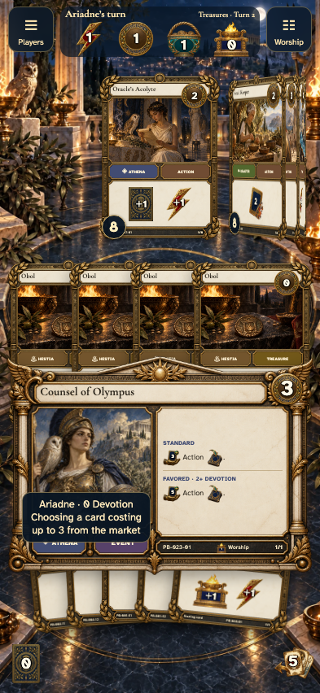</a></td>
</tr>
</table>

Tabletop · 3840 × 2160 — expand screenshot

<a href="../../screenshots/share-market-browsing-and-the-complete-worship-scene-with-an-observer/002-choice-tabletop-4k-darwin.png">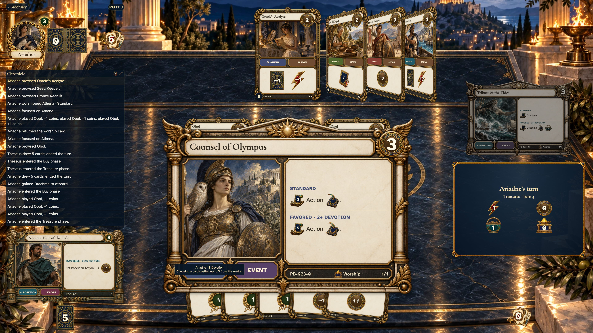</a>

- [x] Gain browsing is synchronized and private hands remain concealed.

## After gaining, the worship card returns for both players

<table>
<tr><th>Desktop · 1440 × 1000</th><th>Phone · 393 × 852</th></tr>
<tr>
<td valign="top"><a href="../../screenshots/share-market-browsing-and-the-complete-worship-scene-with-an-observer/003-returned-desktop-darwin.png">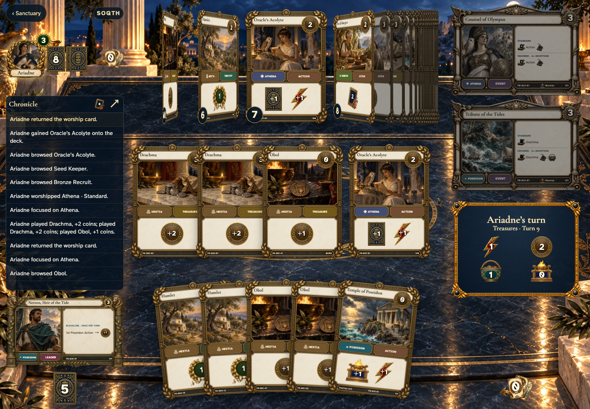</a></td>
<td valign="top"><a href="../../screenshots/share-market-browsing-and-the-complete-worship-scene-with-an-observer/003-returned-phone-darwin.png">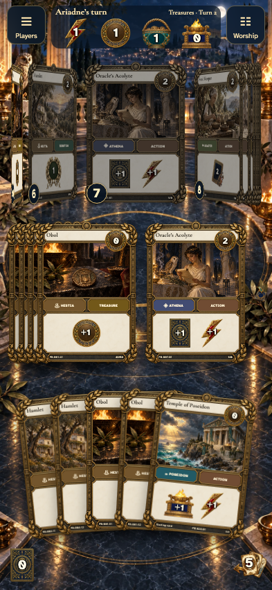</a></td>
</tr>
</table>

Tabletop · 3840 × 2160 — expand screenshot

<a href="../../screenshots/share-market-browsing-and-the-complete-worship-scene-with-an-observer/003-returned-tabletop-4k-darwin.png">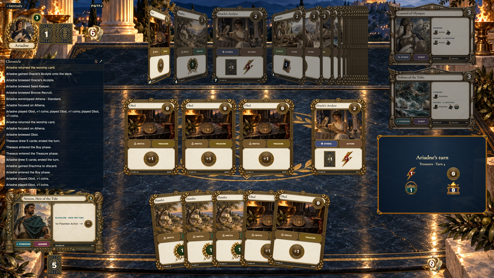</a>

- [x] The shared scene closes and the public gain is recorded once.
