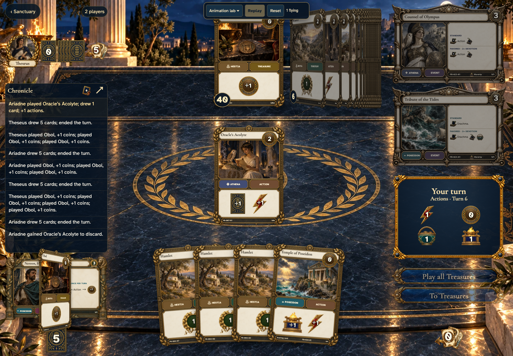
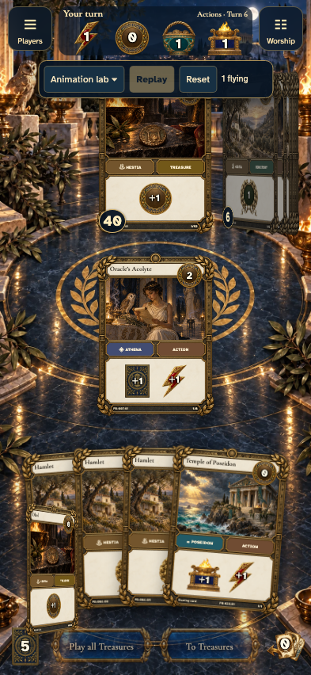
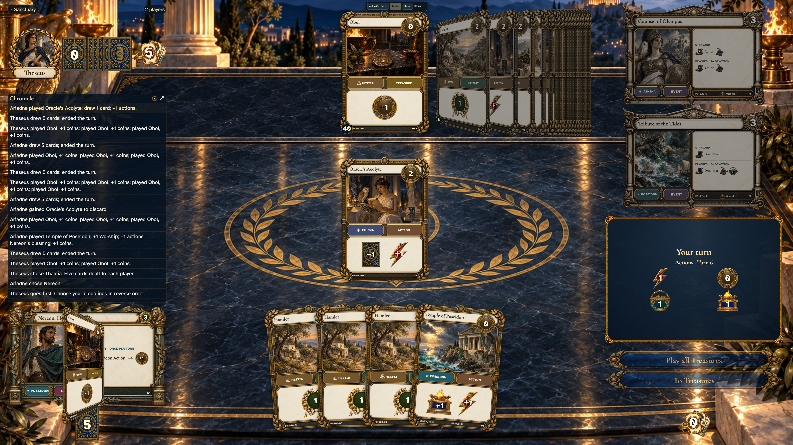
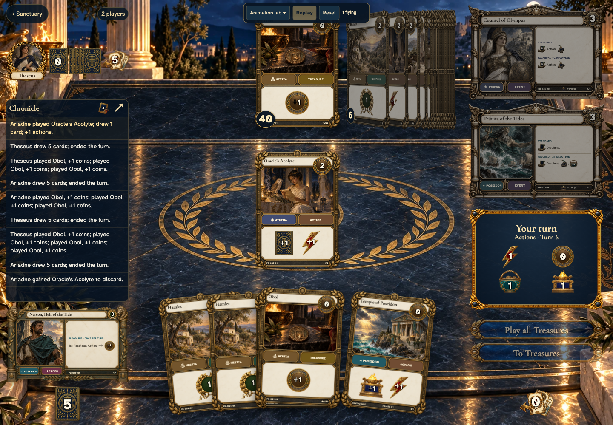
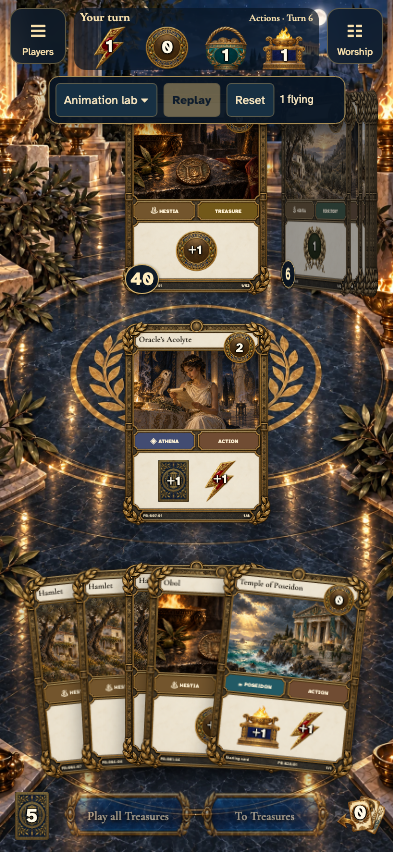
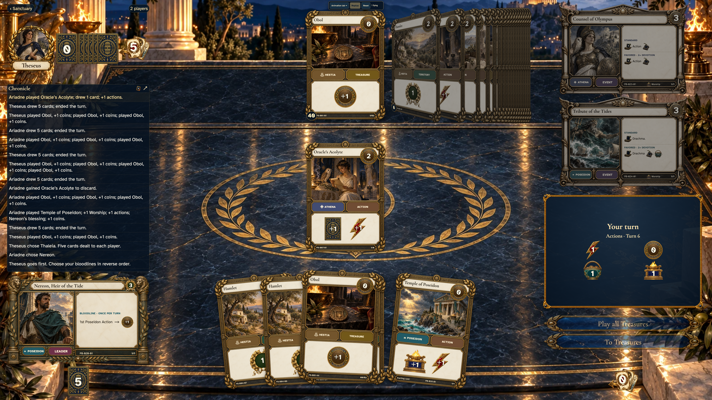

# Oracle draw reveals and lands in its sorted hand layer

## The deck card flips before a hand slot opens

<table>
<tr><th>Desktop · 1440 × 1000</th><th>Phone · 393 × 852</th></tr>
<tr>
<td valign="top"></td>
<td valign="top"></td>
</tr>
</table>

Tabletop · 3840 × 2160 — expand screenshot

- [x] The presented hand still has its original four cards

## The revealed card enters the hand in its final stacking layer

<table>
<tr><th>Desktop · 1440 × 1000</th><th>Phone · 393 × 852</th></tr>
<tr>
<td valign="top"></td>
<td valign="top"></td>
</tr>
</table>

Tabletop · 3840 × 2160 — expand screenshot

- [x] Exactly one hand slot opened
- [x] The flight shares the hand stacking context
