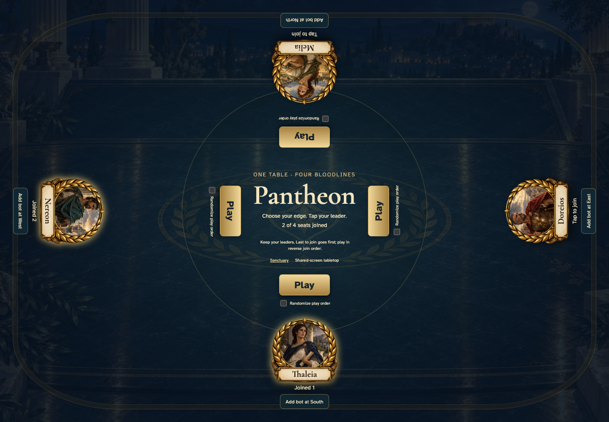
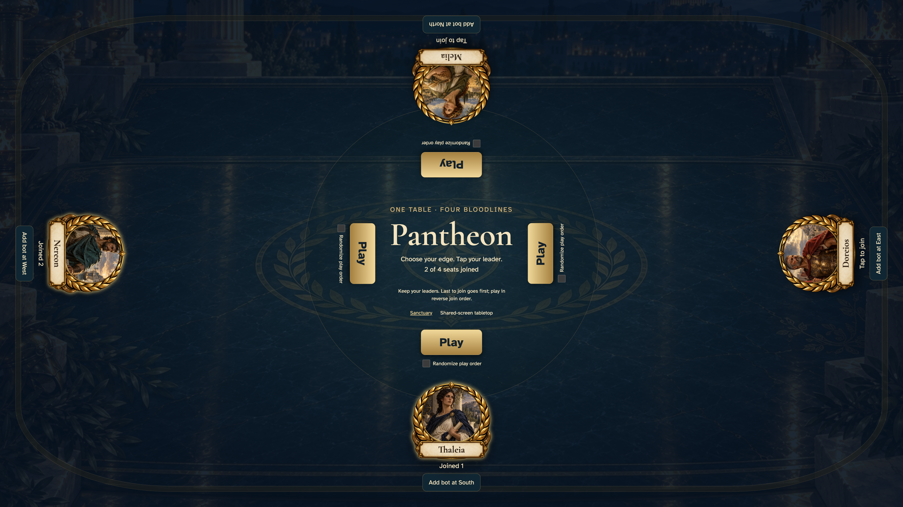

# tabletop 2 players join their edges and keep reverse join order

Shared tabletop: desktop and 4K displays only.

## Players join leaders from their own edge

<table>
<tr><th>Desktop · 1440 × 1000</th></tr>
<tr><td></td></tr>
</table>

Tabletop · 3840 × 2160 — expand screenshot

- [x] Every joined edge can leave before the game starts
- [x] A Play button faces every edge
