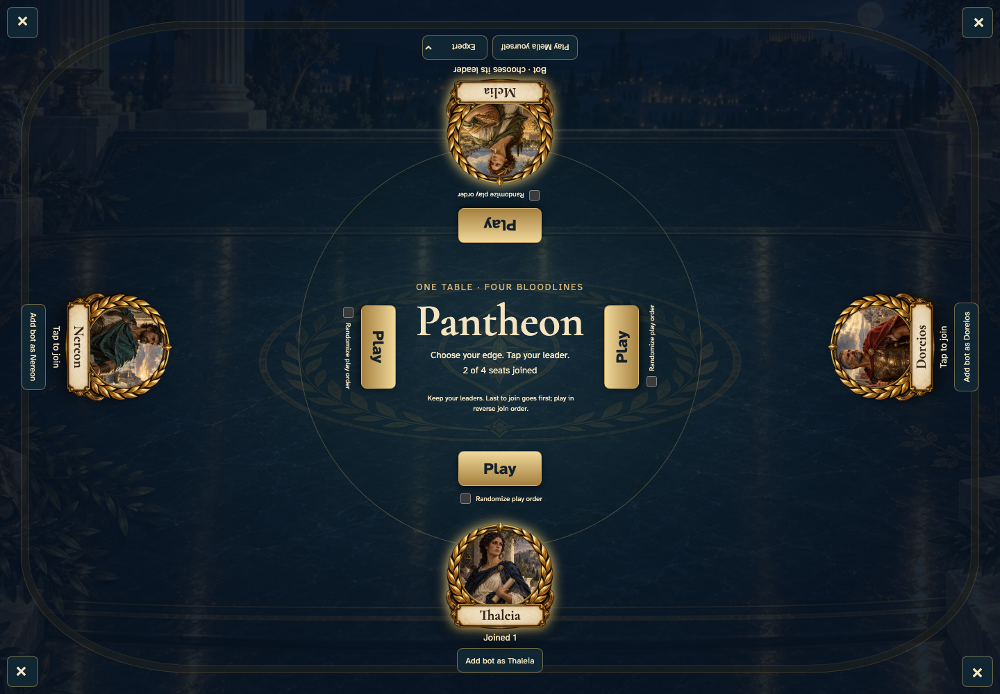
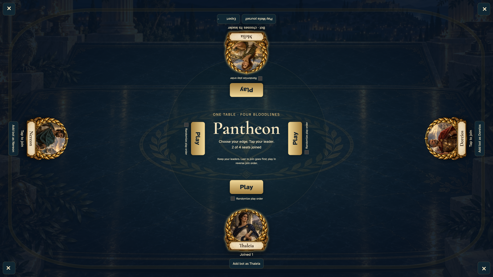

# tabletop bot occupies an edge and plays through the real worker

Shared tabletop: desktop and 4K displays only.

## Choose Expert at the bot’s edge

<table>
<tr><th>Desktop · 1440 × 1000</th></tr>
<tr><td></td></tr>
</table>

Tabletop · 3840 × 2160 — expand screenshot

- [x] Expert is selected before starting the game.
