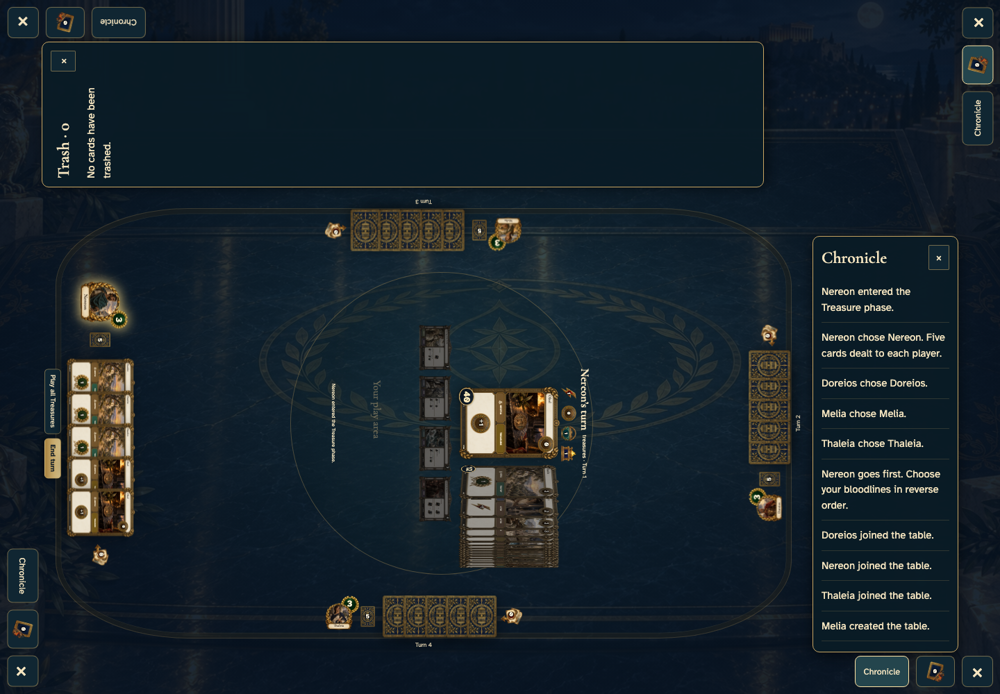
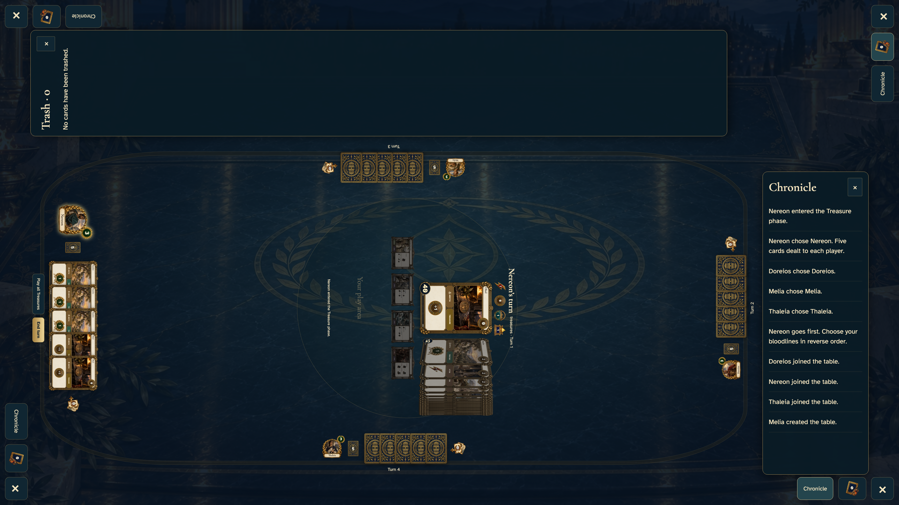

# tabletop corner readers face their player and stay outside the playable table

Restore the legal seeded four-seat game to make the reading panels and turn handoff reproducible.

Shared tabletop: desktop and 4K displays only.

## Two players can read without covering the table

<table>
<tr><th>Desktop · 1440 × 1000</th></tr>
<tr><td></td></tr>
</table>

Tabletop · 3840 × 2160 — expand screenshot

- [x] Chronicle is docked at Thaleia’s edge
- [x] The trash pile opens and explains an empty pile
