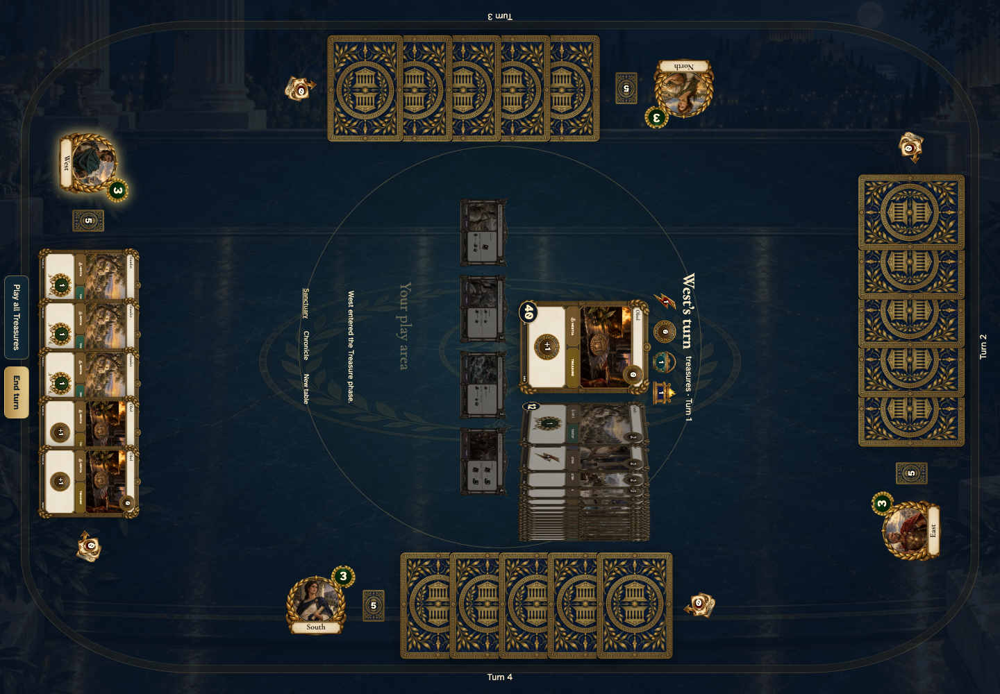
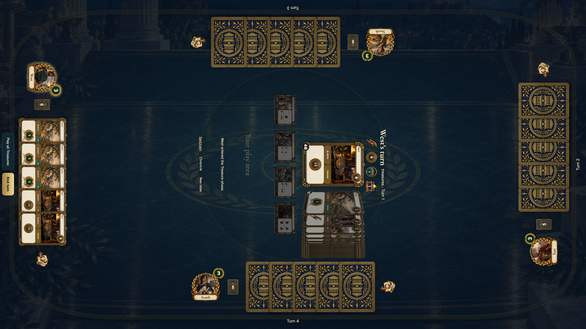

# tabletop restored four-edge game shows one face-up hand and a rotated market

Recorded-history integration scenario: restore a legal, seeded local tabletop save. Separate stories cover tapping seats and starting a new game.

Shared tabletop: desktop and 4K displays only.

## The table faces West while the other hands stay face down

<table>
<tr><th>Desktop · 1440 × 1000</th></tr>
<tr><td></td></tr>
</table>

Tabletop · 3840 × 2160 — expand screenshot

- [x] West is the only face-up hand
- [x] Shared cards rotate toward West
