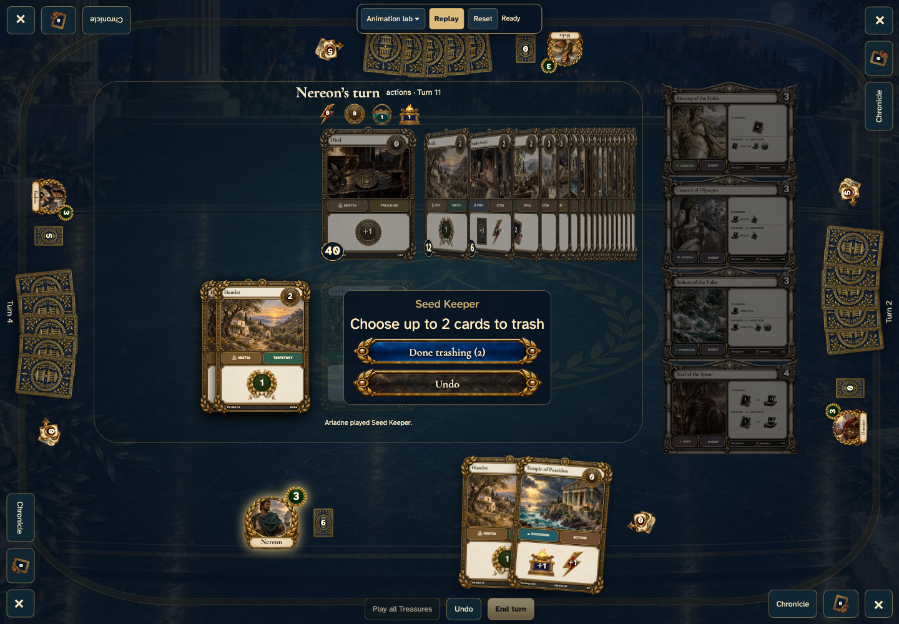
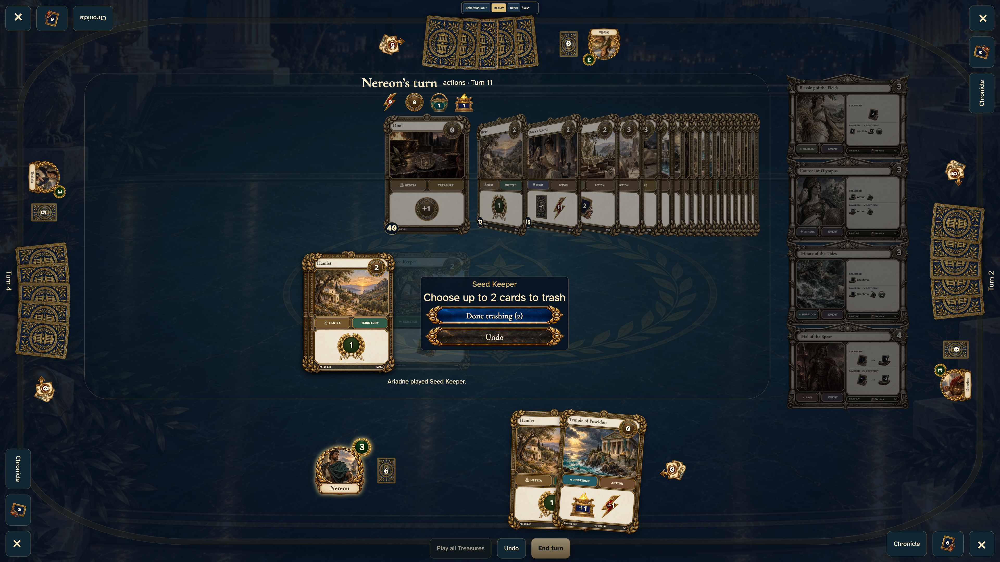

# tabletop south seed-keeper stages cards centrally before confirmation

Shared tabletop: desktop and 4K displays only.

The animation lab prepares a seeded legal card history using the real tabletop surface.

## Selected cards gather on the central target before confirmation

<table>
<tr><th>Desktop · 1440 × 1000</th></tr>
<tr><td></td></tr>
</table>

Tabletop · 3840 × 2160 — expand screenshot

