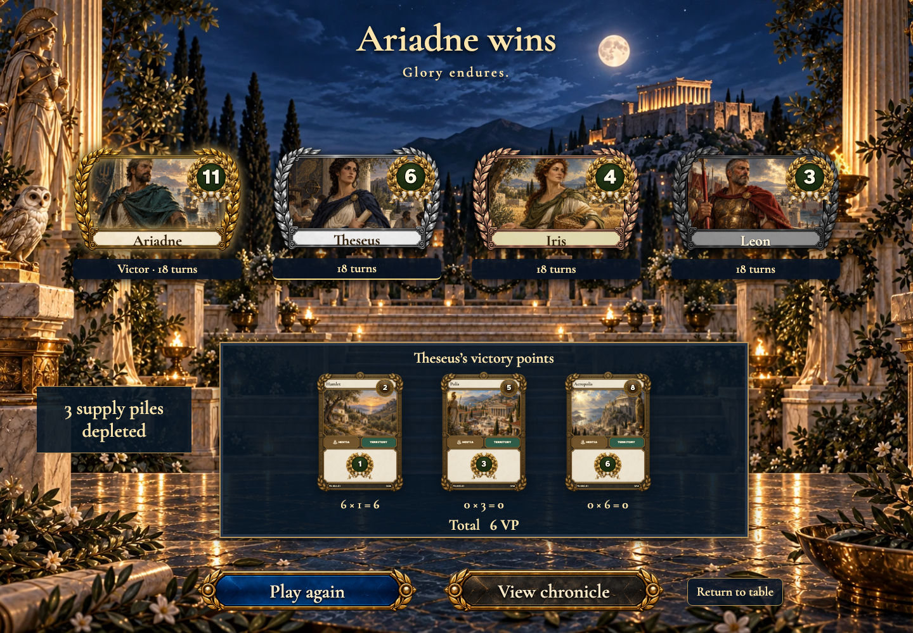
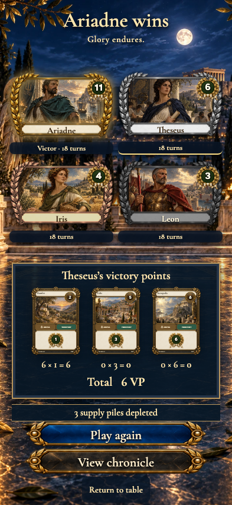
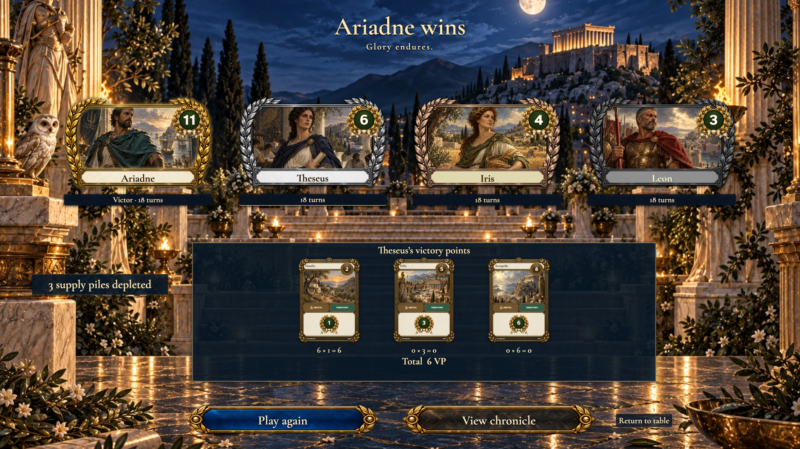

# victory keeps its explicit timing and distinct placement metals

## Gold, silver, copper and lead identify four distinct scores

<table>
<tr><th>Desktop · 1440 × 1000</th><th>Phone · 393 × 852</th></tr>
<tr>
<td valign="top"></td>
<td valign="top"></td>
</tr>
</table>

Tabletop · 3840 × 2160 — expand screenshot

- [x] All four placements have landed
